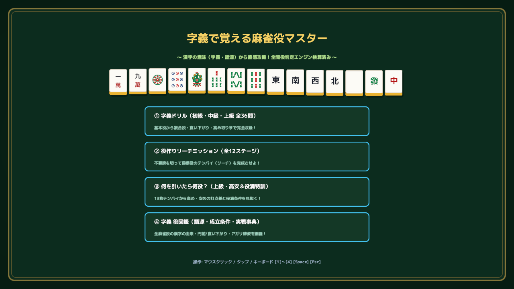
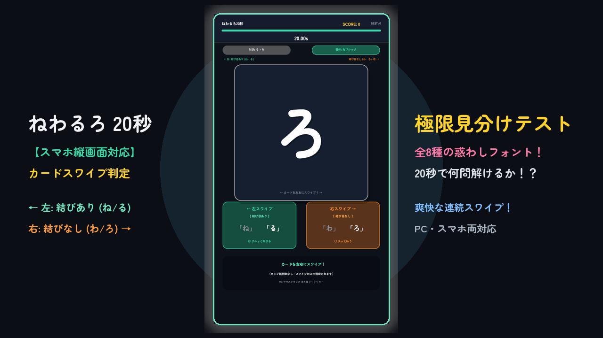
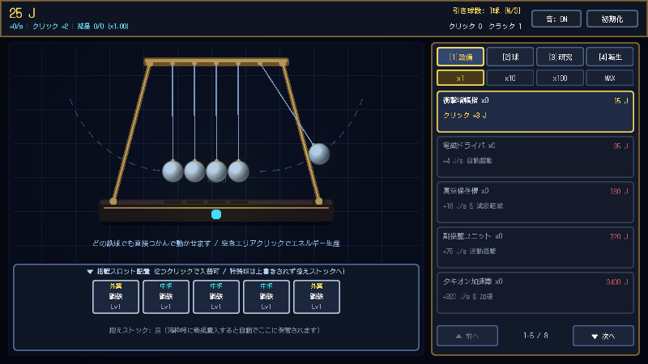
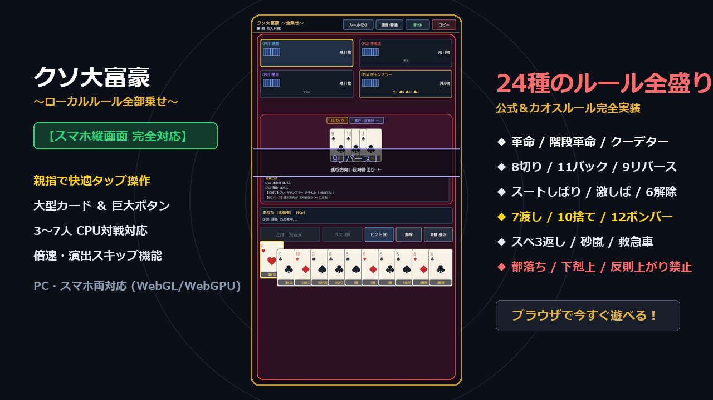
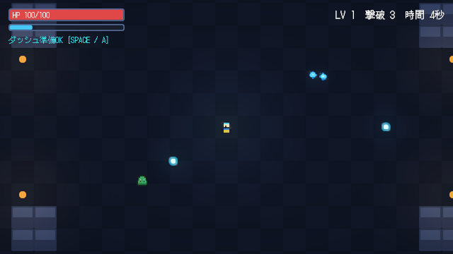

# Lo-Battery Game Portal

ブラウザを開くだけで、インストールや会員登録なしで誰でも気軽に遊べるゲームポータルサイトです。

- 公開URL: **https://lo-battery.github.io/**
- エンジン: 独自2Dゲームエンジン **Gmini**（Rust + WebAssembly / WebGPU / WebGL2）

---

## 収録ゲーム一覧

| サムネイル | タイトル | タグ | ジャンル / 操作 |
| :---: | :--- | :--- | :--- |
|  | **字義で覚える麻雀役マスター**<br>`./games/mahjong-master/` | `パズル` `麻雀` `カジュアル` `Gmini` | 漢字の意味・語源から役を直感攻略！役判定クイズ・手牌組み替えパズル・役図鑑<br>🔄 スマホ横画面（タップ）／💻 PC（マウス・数字キー[1]〜[4]即答）両対応 |
|  | **ねわるろ20秒**<br>`./games/newaruro/` | `アクション` `カジュアル` `パズル` `縦画面` `Gmini` | 「ね・わ」「る・ろ」の結び目を見分ける20秒極限スプリント<br>📱 スマホ縦画面（左右スワイプ）／💻 PC横画面（左右クリック・矢印キー）両対応（[M]/[Tab]で切替） |
|  | **ニュートン・クォータ**<br>`./games/newton-cradle/` | `ローグライク` `物理演算` `カジュアル` `Gmini` | 10秒ノルマ達成型 物理演算ローグライク<br>🔄 スマホ横画面（タッチ弾き）／💻 PC推奨（鉄球ドラッグ＆数字キーでドラフト強化） |
|  | **クソ大富豪 〜ローカルルール全部乗せ〜**<br>`./games/kuso-daifugo/` | `カード` `大富豪` `カジュアル` `縦画面` `Gmini` | 24種の公式＆カオスルール全盛りCPU対戦カードゲーム<br>📱 スマホ縦画面（親指タップ特化大型UI）／💻 PC横画面（マウス・Space/P/Hキー）両対応（[M]/[Tab]で切替） |
|  | **Gmini Survivors（試作アクション）**<br>`./games/gmini-survivors/` | `アクション` `ローグライク` `2D` `Gmini` | 見下ろし型2Dローグライクアクション<br>💻 PC推奨（WASD移動＋ダッシュ＋自動攻撃） |

---

## `games.json` メタデータ＆タグ付け規約（AIエージェント・開発者向け）

ポータルのカード表示およびタグ絞り込み機能は、ルートの [`games.json`](./games.json) によって駆動されています。  
新しいゲームを追加、または既存ゲームの情報を更新する際は、**必ず以下のスキーマとタグ付けルールを遵守してください**。

### 1. スキーマ定義
```json
{
  "id": "kebab-case-game-name",
  "title": "日本語ゲームタイトル",
  "subtitle": "簡潔なサブタイトル（ジャンルやゲーム性の要約）",
  "engine": "Gmini 2D Engine (Rust + WebGPU / WebGL2)",
  "url": "./games/<kebab-case-game-name>/index.html",
  "thumbnail": "./assets/<kebab-case-game-name>.png",
  "controls": "操作説明テキスト（キーボード・マウス・タップ等の対応）",
  "platform_note": "対応環境表記（例: PC/タブレットブラウザ向け（WebGPU / WebGL2・インストール不要））",
  "tags": ["メインジャンル", "ゲーム特徴1", "ゲーム特徴2", "Gmini"]
}
```

### 2. タグ付けルール (`tags`)
1. **タグ件数**: 1ゲームにつき **3〜5個** を指定する。
2. **必須タグ**: Gmini 製ゲームは必ず末尾に `"Gmini"` を含める。
3. **第1タグ（メインジャンル）**: ユーザーが一目でゲーム分類を理解できるよう、大枠のジャンルを指定する。  
   - 例: `"アクション"`, `"クリッカー"`, `"カード"`, `"パズル"`, `"シューティング"`, `"RPG"`, `"シミュレーション"`, `"レース"`
4. **第2・第3タグ（システム・コア要素）**: ゲームの特徴的なメカニクスやプレイ感を指定する。  
   - 例: `"物理演算"`, `"放置"`, `"ローグライク"`, `"大富豪"`, `"カジュアル"`, `"対戦"`, `"サバイバー"`, `"タワーディフェンス"`
5. **第4タグ（任意・次元/スタイル）**: 必要に応じて `"2D"`, `"レトロ"`, `"ドット絵"` など。
6. **表記揺れの禁止**: 検索・フィルター性を高めるため、余計な語尾を付けず簡潔な名詞で統一する（× `アクションゲーム` → ◯ `アクション`、× `トランプ` → ◯ `カード`）。

### 3. デバイス対応表記ルール（重要）
ポータル画面では、サムネイル右上にデバイス適性バッジが自動表示されます。
- `📱 スマホ対応`: **縦画面（ポートレート）** で快適に遊べるゲームのみに付与する厳格規則です。`platform_note` または `controls` に「縦画面」を含めるか、タグに「縦画面」を設定してください。横画面前提のゲームに安易に「スマホ対応」と表記してはいけません。
- `🔄 スマホ横画面`: タッチ・スワイプ操作に対応しているが、**端末を横向きに回転する必要があるゲーム**に付与されます（`platform_note` や `controls` に「スマホ横画面」「スワイプ」「タップ」等を記載）。
- `💻 PC推奨`: キーボード（WASD操作等）や精密なマウス操作が必要なPC向けゲームに付与されます。

---

## ゲームの追加・公開フロー

1. **ゲーム開発**: `C:\Users\morut\Games\<game_name>\` 内で開発・テスト。
2. **WASMビルド＆ポータル同期**: `C:\Users\morut\Games\publish_to_portal.bat` を実行（`newton_cradle`, `kuso_daifugo`, `sample_game` 等の WASM + HTML が `Lo-Battery.github.io/games/` に配備されます）。
3. **サムネイル配置**: `C:\Users\morut\Lo-Battery.github.io\assets\<id>.png` に 16:9 スクリーンショットを配置。
4. **`games.json` 更新**: 上記のタグ付け規約に従ってエントリを追加。
5. **GitHub へ反映**: `C:\Users\morut\Lo-Battery.github.io\push_portal.bat` を実行。1〜2分で GitHub Pages に自動反映されます。
