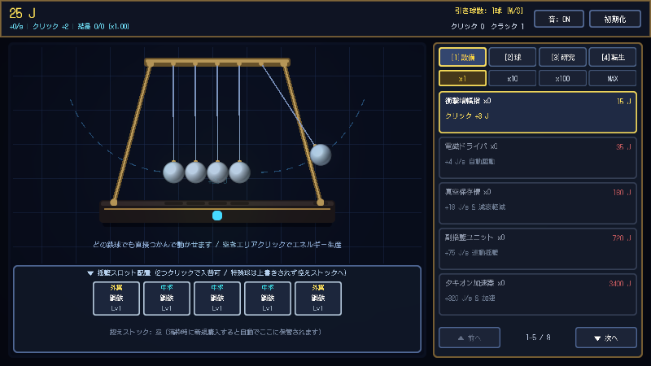
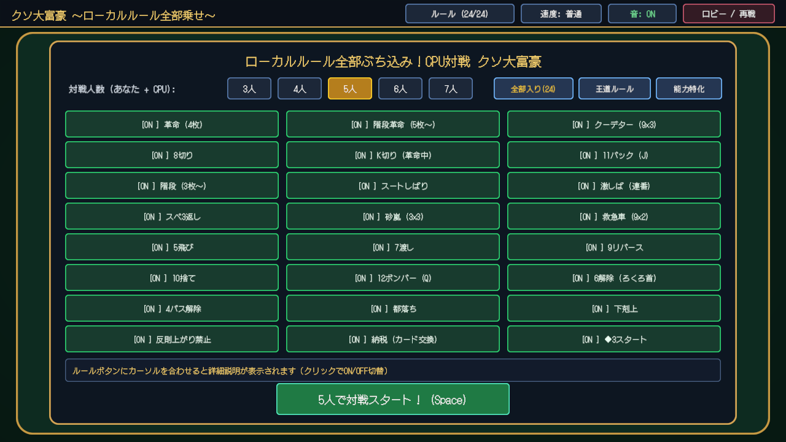
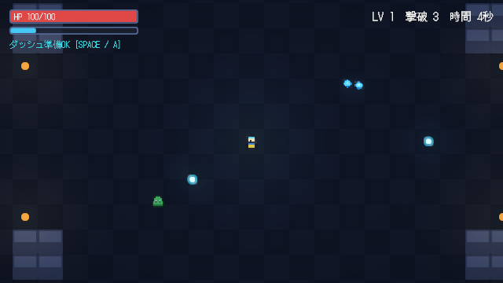

# Lo-Battery Game Portal

ブラウザを開くだけで、インストールや会員登録なしで誰でも気軽に遊べるゲームポータルサイトです。

公開URL: **https://lo-battery.github.io/**

すべてのゲームは独自2Dゲームエンジン **Gmini**（Rust + WebAssembly / WebGPU / WebGL2）で開発されています。

---

## 収録ゲーム一覧

| サムネイル | タイトル | ジャンル / 操作 |
| :---: | :--- | :--- |
|  | **ニュートンの揺籃クリッカー** `./games/newton-cradle/` | 物理演算×クリッカー放置ゲーム 鉄球を掴んで弾いてエネルギー生産・アップグレード |
|  | **クソ大富豪 〜ローカルルール全部乗せ〜** `./games/kuso-daifugo/` | 24種の公式＆カオスルール全盛りCPU対戦カードゲーム 3〜7人対戦・革命・階段・クーデター・砂嵐・都落ちなど |
|  | **Gmini Survivors（試作アクション）** `./games/gmini-survivors/` | 見下ろし型2Dローグライクアクション WASD移動＋ダッシュ＋自動攻撃・経験値＆レベルアップ |

---

## ゲームの追加・更新フロー

1. `C:\Users\morut\Games\publish_to_portal.bat` を実行（WASMビルドとポータル同期）
2. `C:\Users\morut\Lo-Battery.github.io\push_portal.bat` を実行（GitHub へ commit & push）
3. 1〜2分後に GitHub Pages（https://lo-battery.github.io/）へ自動反映されます。
